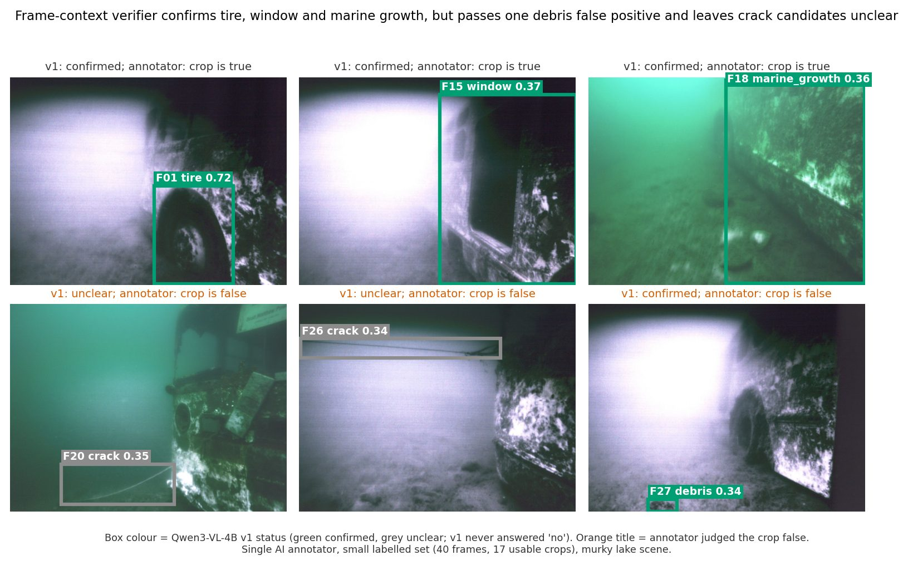
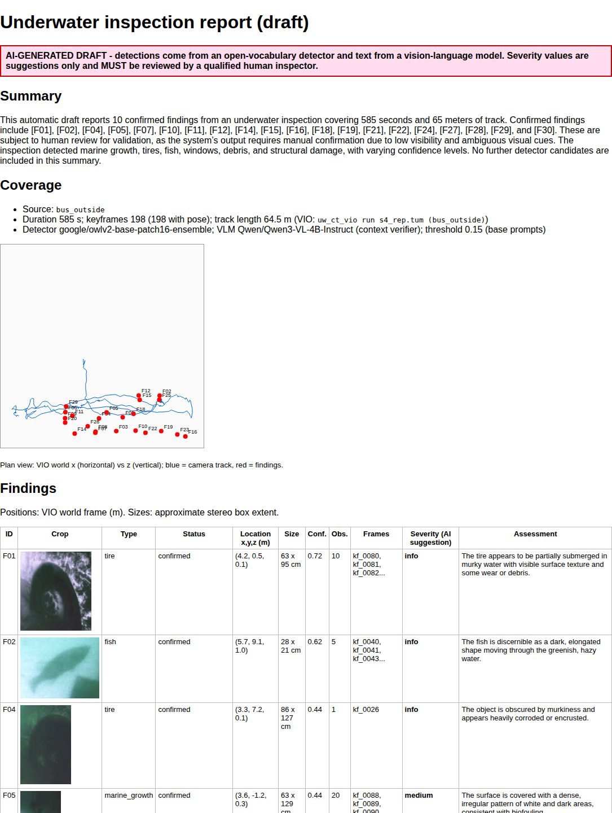
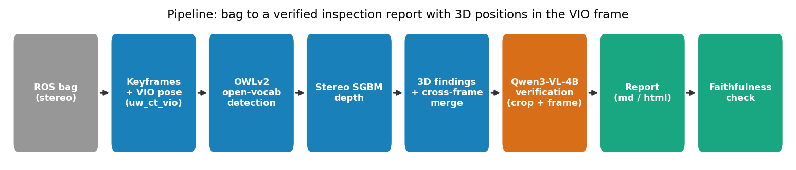
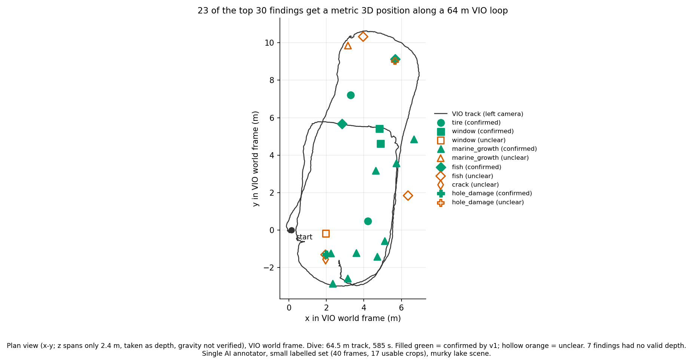

# uw-inspect-report

Research prototype that turns an underwater stereo bag plus VIO poses into a draft inspection report: open-vocabulary
detection, stereo 3D localisation, a local VLM that verifies each finding, and a markdown/HTML report.

| Findings on real keyframes (top: true, bottom: failure cases) | Generated report (AI draft) |
|---|---|
| [](docs/figures/hero_findings.jpg) | [](examples/report.md) |
| AFRL `bus_outside` (sunken bus, murky lake); F20, F26 crack candidates and F27 debris are false positives | its "10 confirmed" is wrong (20 confirmed), which the faithfulness check flags ([report.md](examples/report.md)) |

| Pipeline | Findings on the VIO track |
|---|---|
| [](docs/figures/pipeline.png) | [](docs/figures/map_findings.png) |

## Results

ONE run on `bus_outside`, RTX 5080; labels from one AI annotator (40 frames, 17 usable finding crops), no human
cross-check: **indicative only**.

Detector (OWLv2-base, image level, threshold 0.15, micro over classes):

| prompts | precision | recall |
|---|---|---|
| `base` (first prompt) | 0.49 | 0.29 |
| `ens` (max over 3 prompts) | 0.44 | 0.42 |

VLM verifier (Qwen3-VL-4B-Instruct) on the finding crops (detector crop precision 8/17 = 0.47):

| verifier | recall of true crops | precision after filter | accuracy |
|---|---|---|---|
| v0: crop only | 0/8 = 0.00 | undefined (kept none) | 9/17 = 0.53 |
| **v1: boxed keyframe + crop** | **8/8 = 1.00** | **8/9 = 0.89** | **16/17 = 0.94** |

v1 was chosen on this same small set; 12 crops it confirmed could not be labelled, so its true precision is unknown.
End to end for 198 keyframes: about 36 s detection + 4 s stereo + 85 s VLM (v1).

## Quick start

```bash
python3 -m pytest tests                               # unit tests, no models
./run_all.sh <bag.db3> <camchain.yaml> <poses.tum> <out_dir>   # full pipeline (creates .venv, downloads models)
python3 rescore.py --run run_bus_v1 --inputs run_bus --traj <tum>   # re-score saved outputs, no model
```

## More

- [docs/RESULTS.md](docs/RESULTS.md): all figures, per-class detector table and threshold sweep, verifier and
  faithfulness analysis, per-stage runtime.
- [docs/USAGE.md](docs/USAGE.md): the one-command run and its environment variables, labelling, stages and files,
  models and licences, the full list of known limits.
- [examples/report.md](examples/report.md) / `examples/report.html`: the example report.

Known limits: single scene and annotator, lexical faithfulness check, VLM severity is uncalibrated; the draft must not be
used without human review. Models: OWLv2 and Qwen3-VL-4B-Instruct, both Apache-2.0.
